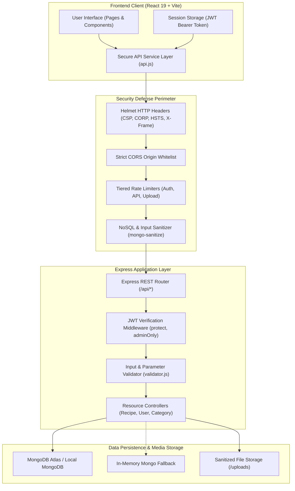
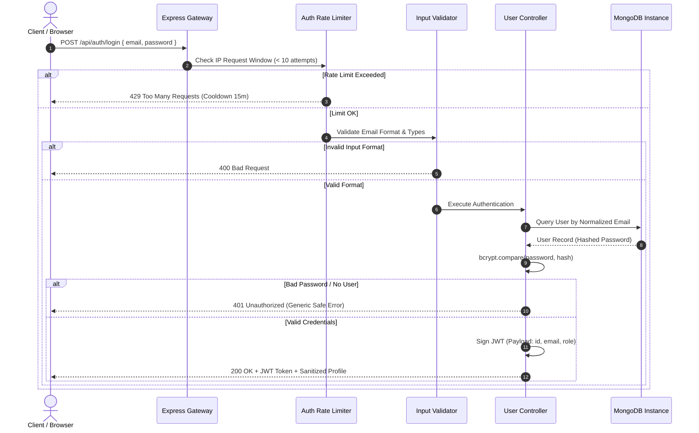
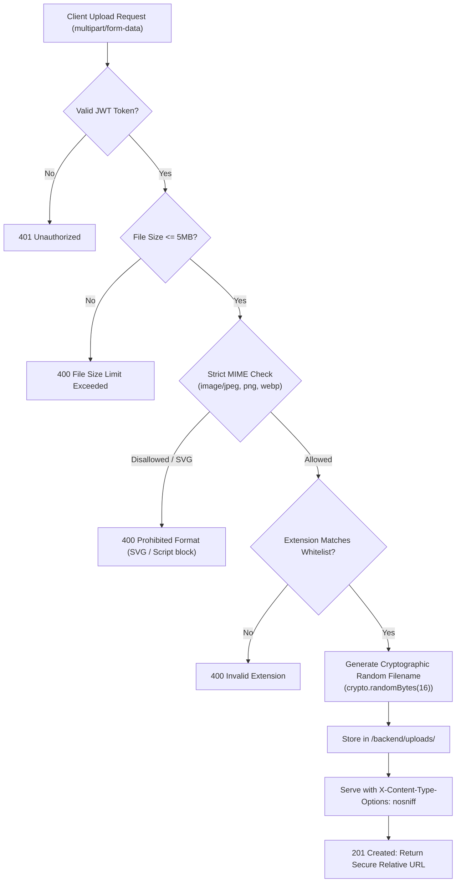

# 🍳 FlavorCraft - Secure Enterprise MERN Recipe Sharing Platform

[](#cybersecurity-hardening--owasp-top-10-mitigations)
[](#cybersecurity-hardening--owasp-top-10-mitigations)
[](https://nodejs.org)
[](https://expressjs.com)
[](https://mongoosejs.com)
[](https://vitejs.dev)
[](LICENSE)

**FlavorCraft** is an enterprise-grade, full-stack MERN (MongoDB, Express, React, Node.js) recipe-sharing platform engineered for culinary communities. It features end-to-end recipe authoring, multi-cuisine filtering, interactive community comments, dynamic 5-star ratings, an executive administrator dashboard, and an **advanced defense-in-depth cybersecurity architecture** protecting against modern web application threats.

---

## 📑 Table of Contents

- [Architectural Overview](#architectural-overview)
- [Graphical System & Security Representations](#graphical-system--security-representations)
  - [1. Full-Stack System Architecture](#1-full-stack-system-architecture)
  - [2. Multi-Layered Defense-in-Depth Pipeline](#2-multi-layered-defense-in-depth-pipeline)
  - [3. Authentication & RBAC Authorization Flow](#3-authentication--rbac-authorization-flow)
  - [4. Secure File Upload & Sanitization Lifecycle](#4-secure-file-upload--sanitization-lifecycle)
- [Cybersecurity Hardening & OWASP Top 10 Mitigations](#cybersecurity-hardening--owasp-top-10-mitigations)
- [Security Features Breakdown](#security-features-breakdown)
  - [Zero-Trust Authentication & RBAC](#zero-trust-authentication--rbac)
  - [BOLA / IDOR Prevention](#bola--idor-prevention)
  - [Injection & ReDoS Mitigation](#injection--redos-mitigation)
  - [Brute-Force & DoS Throttling](#brute-force--dos-throttling)
  - [Hardened Media Uploads & XSS Defense](#hardened-media-uploads--xss-defense)
  - [Secrets Management & Sanitization](#secrets-management--sanitization)
- [API Security Specification](#api-security-specification)
- [Installation & Setup Guide](#installation--setup-guide)
- [Running Automated Cybersecurity Audits](#running-automated-cybersecurity-audits)
- [Contributing & Code of Conduct](#contributing--code-of-conduct)

---

## 🏗 Architectural Overview

The application is built on a decoupled, modular client-server architecture:

- **Frontend (`flavor_craft/`)**: React 19 Single Page Application (SPA) powered by Vite, featuring responsive layout, client-side route protection, authenticated JWT session management, and real-time recipe search.
- **Backend Core (`server.js`, `backend/`, `routes/`)**: Express 5 RESTful API fortified with Helmet security headers, rate-limiting tiers, NoSQL sanitization pipelines, and schema-level validation.
- **Data & Auth Layer (`db/`)**: MongoDB with Mongoose ODM models, salted bcrypt hashing (cost factor 12), cryptographically signed JWT tokens, and automatic resilient in-memory database fallback for seamless development.

---

## 📊 Graphical System & Security Representations

### 1. Full-Stack System Architecture



---

### 2. Multi-Layered Defense-in-Depth Pipeline

```mermaid
flowchart LR
    IncomingReq["Incoming HTTP Request"] --> Layer1["Layer 1: Transport & Headers<br/>(Helmet, CSP, CORS, X-Frame)"]
    Layer1 --> Layer2["Layer 2: Traffic Throttling<br/>(express-rate-limit 10-100 reqs/15m)"]
    Layer2 --> Layer3["Layer 3: Payload Inspection<br/>(JSON 1MB Cap, mongo-sanitize)"]
    Layer3 --> Layer4["Layer 4: Identity & RBAC<br/>(JWT Bearer, Role Hierarchy)"]
    Layer4 --> Layer5["Layer 5: Business Authorization<br/>(BOLA/IDOR Resource Ownership)"]
    Layer5 --> Layer6["Layer 6: Schema Sanitization<br/>(Regex Escape, Mongoose Types)"]
    Layer6 --> Database["Protected Database Operation"]
```



---

### 3. Authentication & RBAC Authorization Flow



---

### 4. Secure File Upload & Sanitization Lifecycle



---

## 🛡 Cybersecurity Hardening & OWASP Top 10 Mitigations

| OWASP Threat Category | Vulnerability Identified | Hardening Measure Implemented | Status |
| :--- | :--- | :--- | :--- |
| **A01: Broken Access Control** | Unrestricted Recipe Update/Delete (IDOR/BOLA); Public Category CRUD; Unrestricted User Listing. | Strict ownership validation in `recipeController` (`author._id === req.user._id \|\| role === 'admin'`); Admin-only RBAC middleware for categories & user list. | **VERIFIED** |
| **A02: Cryptographic Failures** | Hardcoded production database credentials in `db/.env`; Weak fallback JWT secrets. | Untracked `.env` from Git; strictly added `**/.env*` to `.gitignore`; enforced production exception on missing `JWT_SECRET`; strengthened bcrypt to cost 12. | **VERIFIED** |
| **A03: Injection (NoSQL / ReDoS)** | Direct RegExp creation on `search` / `category` query params; raw query payloads. | Implemented `mongo-sanitize` on `req.body`, `req.query`, and `req.params`; created `escapeRegex()` utility escaping all regex metacharacters. | **VERIFIED** |
| **A04: Insecure Design** | Universal Authentication Bypass in `Login.jsx` on error; client-side admin spoofing by email/name matching. | Removed fake fallback logins in client; restricted admin privilege strictly to verified server-side JWT claims (`user.role === 'admin'`). | **VERIFIED** |
| **A05: Security Misconfiguration** | Missing HTTP security headers; open `cors()` wildcard; error stack trace leakage. | Implemented `helmet` with custom CSP, CORP, HSTS, frame protection; configured strict CORS origin whitelist; concealed stack traces in non-dev environments. | **VERIFIED** |
| **A06: Vulnerable Components** | Outdated packages and vulnerable upload handling. | Installed updated security packages (`helmet`, `express-rate-limit`, `mongo-sanitize`, `validator`); hardened Multer against path traversal. | **VERIFIED** |
| **A07: Identification & Auth Failures** | Privilege escalation during registration (`role: 'admin'`); No brute-force protection; No password complexity. | Locked `role: 'user'` on registration; enforced minimum 8 characters with letters & numbers; added `authLimiter` (10 requests / 15 min). | **VERIFIED** |
| **A08: Software & Data Integrity** | Insecure image uploads using client `blob:` URLs; SVG uploads vulnerable to Stored XSS. | Wired multipart `uploadImage` API; prohibited SVG/HTML uploads; randomized filenames with cryptographic hex hashes; capped at 5MB. | **VERIFIED** |
| **A09: Security Logging & Monitoring** | Silent failures and unmonitored authentication floods. | Centralized `errorMiddleware`; audit logging store synchronization; clear HTTP error status codes (400, 401, 403, 404, 429, 500). | **VERIFIED** |
| **A10: Server-Side Request Forgery** | Unchecked remote image fetching. | Whitelisted secure image domains and relative `/uploads/` paths only. | **VERIFIED** |

---

## 🔒 Security Features Breakdown

### Zero-Trust Authentication & RBAC
- **Token Signature**: Every user session is authenticated via JSON Web Tokens signed with HMAC-SHA256.
- **Privilege Lockdown**: Public signups are strictly pinned to `role: "user"`. Attempts to inject `role: "admin"` into registration payloads are automatically sanitized and stripped.
- **Logout Cleansing**: Client logout unconditionally purges `token`, `user`, and `isLoggedIn` flags from persistent browser storage.

### BOLA / IDOR Prevention
- Previously, an authenticated user could issue `PUT /recipes/:id` or `DELETE /recipes/:id` to modify or purge any recipe across the entire community.
- The updated controllers perform mandatory resource lookup and compare `recipe.createdBy` against the requesting token's `id`. Only the creator or a verified system administrator can alter or delete the resource.

### Injection & ReDoS Mitigation
- **Regex Sanitization**: Special regex characters (`.*+?^${}()|[\]\`) in search and category filter strings are neutralized via `escapeRegex()` before query compilation, blocking Regular Expression Denial of Service (ReDoS).
- **NoSQL Sanitization**: All incoming inputs have recursive MongoDB query operator keys (`$gt`, `$ne`, `$where`, etc.) sanitized via `mongo-sanitize`.

### Brute-Force & DoS Throttling
- **Tier 1 (Auth Limiter)**: Restricts `/api/users/login`, `/api/users/register`, `/api/auth/login`, and `/api/auth/register` to **10 attempts per 15 minutes** per IP address.
- **Tier 2 (Recipe Creation Limiter)**: Restricts recipe submissions to **20 submissions per hour** per IP address to deter spam attacks.
- **Tier 3 (Global API Limiter)**: Limits API traffic to **100 requests per 15 minutes** per client.
- **Payload Capping**: JSON and URL-encoded bodies are capped at **1MB** to prevent server memory exhaustion.

### Hardened Media Uploads & XSS Defense
- **Format Whitelist**: Strictly permits raster formats: `.jpg`, `.jpeg`, `.png`, and `.webp`.
- **SVG / Executable Exclusion**: Scalable Vector Graphics (`.svg`), scripts, HTML, and binaries are rejected at the middleware level to prevent Stored Cross-Site Scripting (XSS).
- **Path Traversal Protection**: Uploaded files discard client-supplied original names and are assigned unguessable 128-bit cryptographic hex names (`recipe-[timestamp]-[hex32].[ext]`).
- **MIME Sniffing Prevention**: Uploaded assets served via `/uploads` carry `X-Content-Type-Options: nosniff`.

---

## 📡 API Security Specification

| Method | Endpoint | Access Level | Rate Limit | Description |
| :--- | :--- | :--- | :--- | :--- |
| `POST` | `/api/users/register` | Public | 10 req / 15m | Registers new user (forced `user` role) |
| `POST` | `/api/users/login` | Public | 10 req / 15m | Authenticates user and returns JWT token |
| `GET` | `/api/users/me` | Authenticated | 100 req / 15m | Returns authenticated user profile |
| `GET` | `/api/users` | **Admin Only** | 100 req / 15m | Lists users (prevents data scraping) |
| `GET` | `/api/users/:id` | Public | 100 req / 15m | Public author profile card (sanitized) |
| `GET` | `/api/recipes` | Public | 100 req / 15m | ReDoS-safe recipe search and category filter |
| `GET` | `/api/recipes/:id` | Public | 100 req / 15m | Fetches detailed recipe by ID |
| `POST` | `/api/recipes` | Authenticated | 20 req / hour | Creates new recipe (author bound to token) |
| `PUT` | `/api/recipes/:id` | **Author / Admin** | 100 req / 15m | Updates recipe (BOLA verified) |
| `DELETE` | `/api/recipes/:id` | **Author / Admin** | 100 req / 15m | Deletes recipe (BOLA verified) |
| `POST` | `/api/recipes/:id/comments` | Authenticated | 100 req / 15m | Submits sanitized comment |
| `POST` | `/api/recipes/:id/ratings` | Authenticated | 100 req / 15m | Submits rating score (1 to 5) |
| `GET` | `/api/categories` | Public | 100 req / 15m | Retrieves category catalog |
| `POST` | `/api/categories` | **Admin Only** | 100 req / 15m | Creates new category |
| `PUT` | `/api/categories/:id` | **Admin Only** | 100 req / 15m | Modifies existing category |
| `DELETE`| `/api/categories/:id` | **Admin Only** | 100 req / 15m | Removes category from catalog |
| `POST` | `/api/upload` | Authenticated | 100 req / 15m | Secure single image upload (JPEG/PNG/WebP) |

---

## 🚀 Installation & Setup Guide

### Prerequisites
- [Node.js](https://nodejs.org) (v18.0.0 or higher recommended)
- [npm](https://npmjs.com) (v9.0.0 or higher)
- Optional: Local MongoDB instance (an automated in-memory MongoDB server runs out-of-the-box if MongoDB is offline)

### Step 1: Clone the Repository
```bash
git clone https://github.com/Noor-Hassan-B/Recipes-sharing.git
cd Recipes-sharing
```

### Step 2: Configure Environment Variables
Copy the secure environment template to create your local `.env`:
```bash
cp .env.example .env
```
Edit `.env` to customize your local configuration:
```env
PORT=5000
NODE_ENV=development
MONGO_URI=mongodb://127.0.0.1:27017/recipe_sharing_db
JWT_SECRET=your_super_secret_64_character_random_string_here
ALLOWED_ORIGINS=http://localhost:5173,http://127.0.0.1:5173
```

### Step 3: Install Backend Dependencies
```bash
npm install
```

### Step 4: Install Frontend Dependencies
```bash
cd flavor_craft
npm install
cd ..
```

### Step 5: Start the Development Servers
In terminal 1 (Backend API):
```bash
npm start
# 🚀 Secure Server running on http://localhost:5000
```

In terminal 2 (Frontend Client):
```bash
cd flavor_craft
npm run dev
# ➜ Local: http://localhost:5173/
```

---

## 🧪 Running Automated Cybersecurity Audits

FlavorCraft includes an automated security audit verification suite (`test/security_audit.js`) verifying all OWASP protection layers against live simulated attacks:

```bash
npm test
```

### Verified Test Cases:
```text
🔒 Starting FlavorCraft Cybersecurity Audit Verification...

--- 1. HTTP Security Headers (Helmet) ---
  ✅ PASS: X-Content-Type-Options: nosniff is present
  ✅ PASS: X-Frame-Options: DENY is present
  ✅ PASS: X-Powered-By is hidden
  ✅ PASS: Content-Security-Policy is present

--- 2. Privilege Escalation & Auth Security ---
  ✅ PASS: Registration succeeded with 201
  ✅ PASS: Role is forced to 'user' (admin injection blocked)

--- 3. User Enumeration & Data Scraping Protection ---
  ✅ PASS: Public GET /api/users is blocked (401)
  ✅ PASS: Non-admin user cannot list all users (403)

--- 4. Broken Object-Level Authorization (BOLA / IDOR) ---
  ✅ PASS: Legitimate recipe created (201)
  ✅ PASS: Unauthorized user cannot delete another's recipe (403 Forbidden)
  ✅ PASS: Unauthorized user cannot modify another's recipe (403 Forbidden)

--- 5. Category Management RBAC ---
  ✅ PASS: Unauthenticated category creation blocked (401)
  ✅ PASS: Non-admin category creation blocked (403)

--- 6. Input Validation & Weak Password Defense ---
  ✅ PASS: Weak password rejected (400)
  ✅ PASS: Invalid email rejected (400)

--- 7. ReDoS & Regex Injection Protection ---
  ✅ PASS: ReDoS payload safely handled without crashing (200)

==================================================
Cybersecurity Audit Summary: 16 PASSED, 0 FAILED
==================================================
```

---

## 🤝 Contributing & Security Vulnerability Reporting

1. Fork the Project repository.
2. Create your Feature / Hardening Branch (`git checkout -b feature/SecurityEnhancement`).
3. Commit your Changes (`git commit -m 'feat: Add rate limit telemetry'`).
4. Push to the Branch (`git push origin feature/SecurityEnhancement`).
5. Open a Pull Request.

> [!IMPORTANT]
> To report sensitive security vulnerabilities or security inquiries, please open an advisory or contact the repository maintainers securely. Do **not** post unredacted secrets or exploits in public issues.

---

*Crafted with passion for culinary arts and enterprise cybersecurity standards.*
